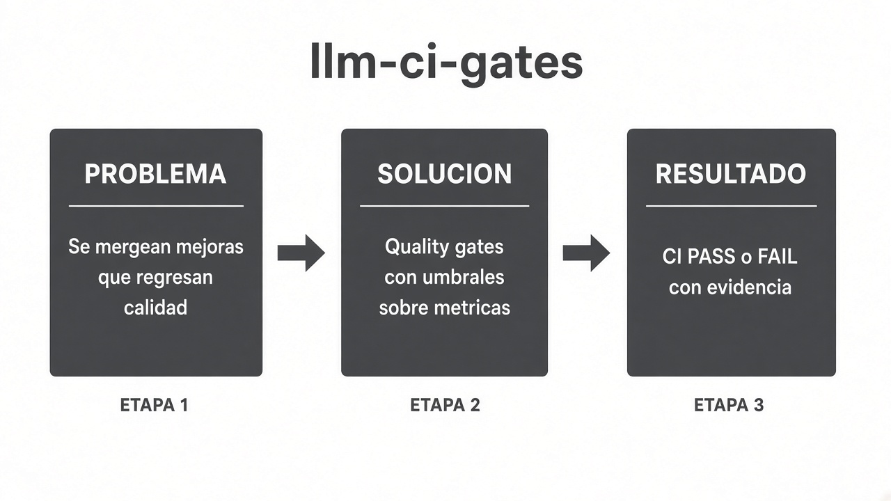
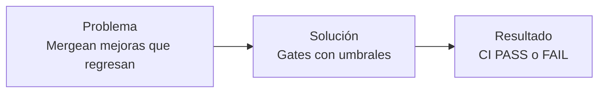

<div align="center">

# llm-ci-gates

**Quality gates para IA** · Angel Salazar

<br/>


</div>

---

### `$ cat diagrama.md`



---

### `$ cat problema.md`

Se mergean “mejoras” que bajan faithfulness/retrieval.  
Este gate lee métricas (p.ej. de `rag-eval-platform`) y falla el job si no pasan umbrales.

---

```bash
pip install -e .
pytest
python -m llm_ci_gates
python -m llm_ci_gates --metrics samples/metrics_fail.json
```

Exit code `2` = GATE FAIL (útil en CI).

---

Hecho en Lima · Angel Salazar · CIP 404730
