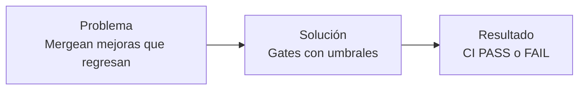
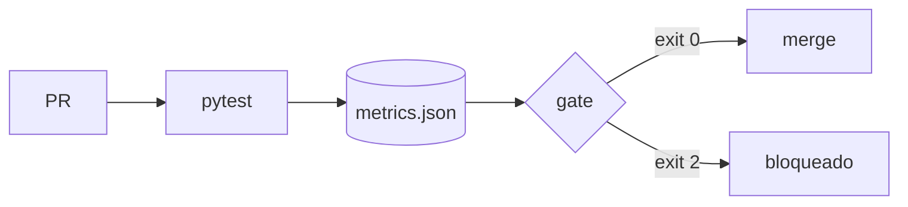

<div align="center">

# llm-ci-gates

**Quality gates para IA** · Angel Salazar

[](https://github.com/Angelzaki/llm-ci-gates/actions/workflows/ci.yml)

<br/>


</div>

---

## Problema

Se mergean “mejoras” a un sistema RAG/LLM que bajan faithfulness o retrieval sin que nadie lo note: los tests unitarios pasan, pero la calidad de las respuestas retrocede. Revisar métricas a mano en cada PR no escala y depende de que alguien se acuerde.

## Hipótesis

Si las métricas de evaluación se tratan como un contrato (umbrales versionados en Git) y el CI falla con un código de salida propio cuando no se cumplen, entonces una regresión de calidad no puede llegar a `main` sin una decisión explícita y revisada.



## Arquitectura

Flujo PR → pytest → métricas → gate PASS/FAIL → merge bloqueado o permitido, más una referencia AWS (CodePipeline + CodeBuild): [docs/architecture.md](docs/architecture.md).



## Uso

```bash
pip install -e .
pytest
python -m llm_ci_gates                                         # samples/metrics.json
python -m llm_ci_gates --metrics samples/metrics_fail.json     # exit 2
```

Entrada: JSON con `overall` y `suites[].name/score` (formato de `rag-eval-platform`) y umbrales en YAML/JSON (`samples/thresholds.yaml`). Exit code `0` = PASS, `2` = FAIL.

## Experimento

Detalle en [docs/EXPERIMENT.md](docs/EXPERIMENT.md). Umbrales: overall ≥ 0.80, cada suite ≥ 0.70.

| Check | `metrics.json` | `metrics_fail.json` | `scenario_a` (rag-eval) | Mínimo |
|---|---:|---:|---:|---:|
| overall | 0.90 | 0.55 | 0.8972 | 0.80 |
| suite.retrieval | 1.00 | 0.40 | 1.0000 | 0.70 |
| suite.faithfulness | 1.00 | 0.50 | 0.8889 | 0.70 |
| suite.abstention | 0.83 | 0.50 | 0.8500 | 0.70 |
| **Resultado** | **PASS (exit 0)** | **FAIL (exit 2)** | **PASS (exit 0)** | |

## Conclusiones

Resumen de [docs/CONCLUSIONS.md](docs/CONCLUSIONS.md):

- Bloquear el merge si cualquier suite o `overall` queda bajo el umbral, o si una métrica requerida desaparece.
- No bajar el umbral de faithfulness para poner el CI en verde: se corrige el cambio, no el contrato. Los cambios de umbral van en PR separado y justificado.
- Límite: con conjuntos de evaluación pequeños los scores son ruidosos; el siguiente paso es comparar contra un baseline.

## Docker

```bash
docker build -t llm-ci-gates .
docker run --rm llm-ci-gates                                   # PASS
docker compose run --rm gate-fail                              # exit 2
docker compose run --rm tests                                  # pytest
```

## CI

[`.github/workflows/ci.yml`](.github/workflows/ci.yml) ejecuta `pip install -e .`, `pytest`, el gate sobre `samples/metrics.json` (debe pasar) y el gate sobre `samples/metrics_fail.json`, donde el job queda verde solo si el CLI devuelve exactamente exit `2`. Un job adicional construye la imagen Docker y corre el gate dentro del contenedor.

## Relación con rag-eval-platform

[`rag-eval-platform`](https://github.com/Angelzaki/rag-eval-platform) mide; `llm-ci-gates` decide. Los `results/scenario_*.json` se pasan tal cual como `--metrics`. Guía en [docs/INTEGRATION.md](docs/INTEGRATION.md).

---

Hecho en Lima · Angel Salazar · CIP 404730
