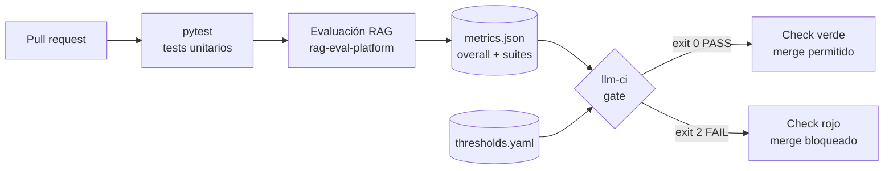
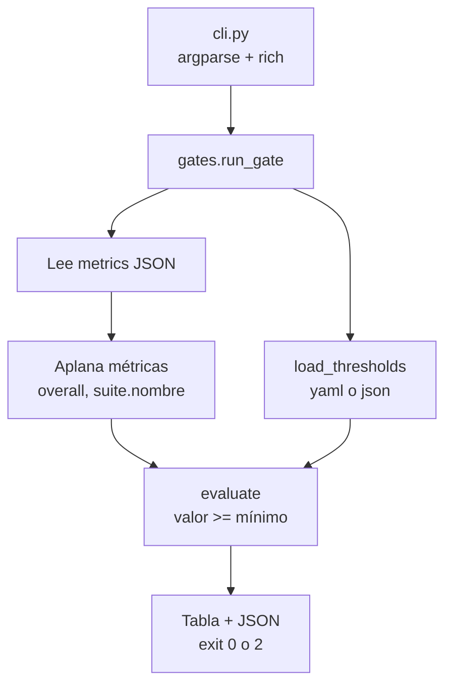
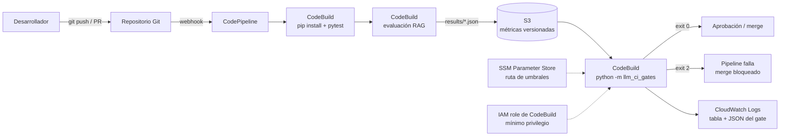

# Arquitectura

`llm-ci-gates` es un paso de CI que convierte métricas de evaluación de un sistema LLM/RAG en una decisión binaria: el PR puede mergearse o no.

## Flujo CI/CD

## Componentes

| Módulo | Responsabilidad |
|---|---|
| `src/llm_ci_gates/cli.py` | Parseo de argumentos, tabla `rich`, línea JSON final y código de salida. |
| `src/llm_ci_gates/gates.py` | Carga de métricas y umbrales, aplanado de `suites[]` y evaluación `valor >= mínimo`. |

Reglas de evaluación:

- Cada clave del archivo de umbrales es un check. Las suites se nombran `suite.<nombre>`.
- Una métrica ausente en el archivo de métricas cuenta como FAIL (no se asume cumplida).
- El gate falla si cualquier check falla; no hay promedios que compensen.

## Referencia AWS

Despliegue de referencia para ejecutar el gate dentro de un pipeline gestionado. Es un diagrama conceptual: no incluye credenciales ni recursos creados por este repositorio.

Notas de la referencia:

- El rol IAM de CodeBuild solo necesita lectura sobre el bucket de métricas y escritura de logs.
- Los umbrales viven en el repositorio (`samples/thresholds.yaml` o un archivo propio), de modo que cambiarlos pasa por revisión de código.
- El mismo contenedor del `Dockerfile` puede usarse como imagen de build en CodeBuild.
